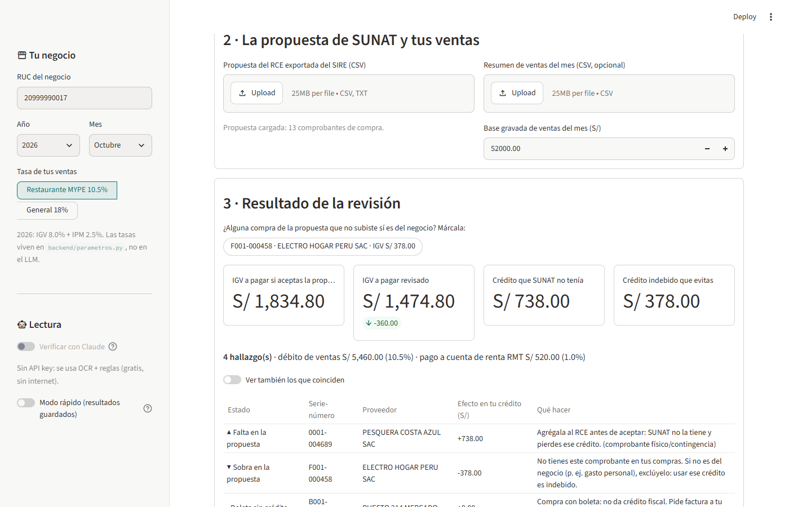
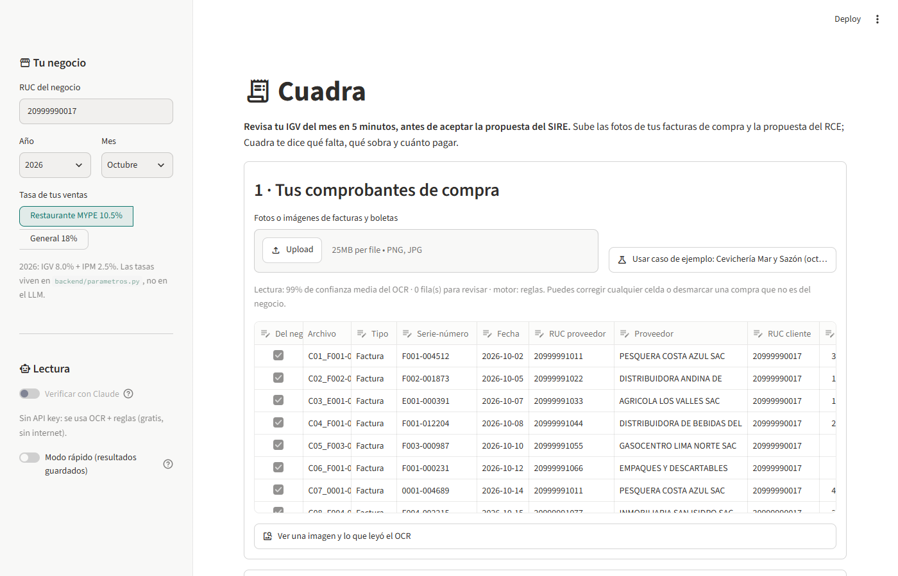
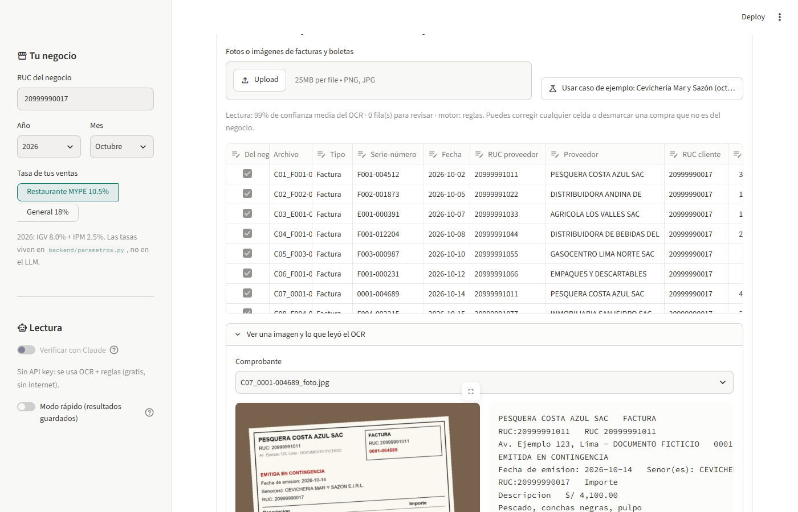
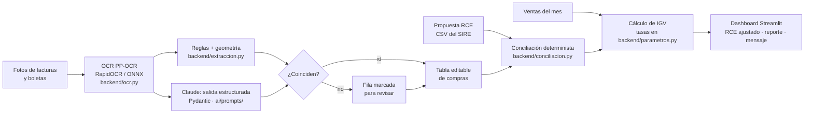

# Cuadra

> **Hacemos que los dueños de restaurantes MYPE revisen su IGV del mes en 5 minutos, mediante la lectura automática de sus facturas de compra y su conciliación contra la propuesta del SIRE, con la tasa especial del rubro.**

**Demo:** https://cuadra-igv.streamlit.app (abre con el caso de ejemplo: https://cuadra-igv.streamlit.app/?demo=1) · **Video de respaldo:** _[link al video de 60-90 s]_ · **Corre en local:** ver [Cómo correrlo](#cómo-correrlo)



---

## 1. One-liner

Hacemos que los dueños de restaurantes MYPE revisen su IGV del mes en 5 minutos, mediante la lectura automática de sus facturas de compra y su conciliación contra la propuesta del SIRE, con la tasa especial del rubro.

## 2. Founder


**Britney Daily Miranda Gutiérrez** · Universidad del Pacífico, Data Science con Python 2026-II.
_[Una línea sobre ti: carrera y tu vínculo con el problema, p. ej. el negocio de tu familia o tus prácticas.]_

Cómo cubro cada frente con agentes de IA:

- **Producto:** definí el problema, el usuario y el alcance (un solo flujo). Claude me ayudó a ordenar la investigación tributaria, que verifiqué contra las normas.
- **Ingeniería:** Claude Code escribió la mayor parte del código bajo mis instrucciones; yo reviso cada módulo y los tests fijan las cifras del caso.
- **Diseño:** Streamlit con componentes nativos y un tema propio; las capturas se generan con un script.
- **Ventas:** el canal son los contadores que llevan varios restaurantes. El mensaje de WhatsApp para el dueño y el reporte para el contador salen de la app.

<br clear="left">

## 3. Problema

**Quién lo sufre.** Los restaurantes MYPE de Lima (cevicherías, menús, pollerías) en el Régimen MYPE Tributario o el RER, con 3 a 15 trabajadores, que venden con boleta (POS, Yape, Plin) y compran a mayoristas y distribuidoras. Y sus contadores externos, que llevan entre 20 y 60 negocios así.

**Qué pasa.** Desde agosto de 2024 el SIRE es obligatorio para el RMT y el RER: cada mes SUNAT arma una **propuesta** del Registro de Compras (RCE) con los comprobantes electrónicos que conoce, y el contribuyente puede aceptarla, complementarla o reemplazarla. Lo más fácil es aceptarla sin revisar, y ahí aparecen dos errores opuestos:

| Error | Ejemplo | Costo |
|---|---|---|
| **Falta** una compra real | Una factura física de contingencia del pescado, que SUNAT no tiene | Se pierde crédito fiscal: se paga IGV de más |
| **Sobra** una compra ajena | El televisor que el dueño compró con el RUC del negocio | Crédito indebido: reparo, intereses y multa si hay fiscalización |

Con la tasa especial de restaurantes (8 % IGV + 2,5 % IPM = 10,5 % en 2026) y compras al 18 %, **el crédito fiscal pesa casi tanto como el débito**: en nuestro caso de ejemplo, S/ 3,985 de crédito contra S/ 5,460 de débito. Un error en compras mueve mucho el IGV a pagar.

**Cuánto cuesta.** En el caso de ejemplo (ficticio pero con montos típicos), aceptar la propuesta lleva a pagar **S/ 1,834.80 en vez de S/ 1,474.80** (S/ 360 de más en un solo mes) y, además, a declarar S/ 378 de crédito indebido. Los dos errores casi se compensan, así que el total "parece razonable": solo una revisión línea por línea los encuentra. A eso se suma el riesgo de la tasa especial: SUNAT está enviando esquelas a restaurantes por vinculación económica, y perder el beneficio obliga a reliquidar a 18 %.

**Cómo lo resuelven hoy.** El dueño junta las facturas en un sobre o las manda por WhatsApp al contador. El contador descarga la propuesta en Excel y, si tiene tiempo, compara a mano; si no, acepta. Nadie revisa si cada compra es del negocio.

**Evidencia.** Notas de 3 conversaciones (2 dueños de restaurante y 1 contador) en [docs/research/](docs/research/).

## 4. Solución e insight

**Qué construimos.** Una app web donde el dueño o su contador:

1. Sube las **fotos** de sus facturas y boletas de compra. El OCR las lee (incluso una foto girada tomada con el celular) y extrae RUC, serie, fecha, base, IGV y total. Claude verifica la lectura con salidas estructuradas; si las dos lecturas no coinciden, la fila queda marcada para revisar.
2. Sube la **propuesta del RCE** que exporta del SIRE y sus ventas del mes.
3. Recibe **qué falta, qué sobra y qué hacer**, y el **IGV a pagar** con y sin la revisión, calculado con código determinista y la tasa especial del rubro. Descarga el RCE ajustado y un reporte para el contador.

**Insight.**

- El SIRE cambió quién arma el registro: antes lo armaba el contador con los comprobantes en la mano; ahora SUNAT propone y el camino fácil es "Aceptar". **El error pasó de ser de digitación a ser de omisión y de aceptación**, y eso solo se detecta comparando contra los documentos físicos del negocio.
- La revisión no necesita "inteligencia" para los números: necesita **leer bien** (OCR + LLM) y **calcular con reglas** (código). El LLM nunca calcula impuestos; las tasas están en un solo archivo, porque cambian por ley (en 2027 la tasa especial sube a 12 % + 3 % IPM, y hay una reforma en discusión).
- El ahorro por restaurante es pequeño en soles (el Consejo Fiscal estima que una empresa RMT promedio paga unos S/ 7,000 de IGV al año), así que **el cliente que paga es el contador**: un mismo contador revisa 30 restaurantes en una mañana.

## 5. Why now

- **El SIRE es obligatorio para MYPE desde agosto de 2024**, y para los nuevos negocios desde el primer día. Hace tres años no existía una "propuesta" contra la cual conciliar.
- **El OCR ya corre gratis en CPU.** Los modelos PP-OCR (PaddleOCR) exportados a ONNX pesan ~32 MB y leen un comprobante en ~1,5 s en un servidor gratuito, sin GPU.
- **Los LLM con salidas estructuradas** devuelven un JSON validado contra un esquema (Pydantic) por menos de un centavo de dólar por comprobante.
- **La tasa especial cambia en 2027** (de 10,5 % a 15 %) y el IPM sube cada año hasta 2029: los restaurantes necesitan recalcular con parámetros, no con la plantilla de Excel del año pasado.

## 6. Demo

**URL:** https://cuadra-igv.streamlit.app · **Caso de ejemplo directo:** `/?demo=1` · **Video:** _[link]_

| 1. Comprobantes leídos | 2. Foto de celular y texto del OCR | 3. Resultado |
|---|---|---|
|  |  |  |

**Caso de ejemplo:** Cevichería Mar y Sazón E.I.R.L., octubre de 2026. 15 comprobantes (13 facturas y 2 boletas), una propuesta del RCE con dos errores plantados y ventas por S/ 52,000. **Todo es ficticio** (RUC, razones sociales, montos). Detalle en [data/caso_sintetico/](data/caso_sintetico/).

### Arquitectura



### Modelos y APIs, y por qué

| Pieza | Qué usamos | Por qué |
|---|---|---|
| OCR | Modelos **PP-OCRv6** de PaddleOCR vía **RapidOCR + ONNX Runtime**, en el servidor | Los mismos modelos de la sesión 10, sin PyTorch ni GPU: entran en el plan gratuito de Streamlit Cloud. La imagen del comprobante no sale del servidor. |
| Verificación de la lectura | **Claude** (`claude-opus-5-5` por defecto, configurable con `CLAUDE_MODEL`) con `messages.parse` y un esquema Pydantic | Devuelve un `Comprobante` validado; solo recibe el texto del OCR, no la imagen. Si no hay API key, la app funciona igual con reglas. |
| Cálculo | Python puro (pandas) | Los impuestos no se le piden a un LLM: código determinista, con tests. |
| Interfaz | Streamlit + Altair | Un solo archivo, despliegue gratis. |

### Cómo correrlo

```bash
git clone https://github.com/BritneyMiranda/cuadra-igv.git
cd cuadra-igv
python -m venv .venv && source .venv/bin/activate   # en Windows: .venv\Scripts\activate
pip install -r requirements.txt
cp .env.example .env            # opcional: pon tu ANTHROPIC_API_KEY para la verificación con Claude
streamlit run app/streamlit_app.py
```

Abre http://localhost:8501 y pulsa **"Usar caso de ejemplo"**. Pruebas: `pytest`. Evaluación de la extracción: `python scripts/evaluar_extraccion.py`.

**Despliegue (Streamlit Community Cloud):** New app → repo `cuadra-igv`, rama `main`, archivo `app/streamlit_app.py`, Python 3.12. La API key va en *Settings → Secrets* como `ANTHROPIC_API_KEY = "..."`, nunca en el repo.

### Evaluación

Sobre los 15 comprobantes del caso, OCR + reglas extrae **100 % de los campos** (tipo, serie, fecha, RUC del proveedor y del cliente, base, IGV y total), incluida la foto girada, y las cifras finales coinciden con `resultado_esperado.json`. Detalle: [docs/evaluacion_extraccion.md](docs/evaluacion_extraccion.md). Es un caso sintético con imágenes limpias: con fotos reales la exactitud será menor, y por eso existe la doble lectura y la tabla editable.

## 7. Modelo de negocio

**Quién paga:** el contador o estudio contable que lleva varios restaurantes (canal principal) y, en segundo lugar, el dueño que lleva sus cuentas.

| Plan | Para quién | Precio | Incluye |
|---|---|---|---|
| **Dueño** | 1 restaurante | **S/ 39 al mes** | 1 RUC, hasta 100 comprobantes al mes |
| **Contador** | Contador independiente | **S/ 199 al mes** | Hasta 20 RUC (≈ S/ 10 por cliente) |
| **Estudio** | Estudio contable | **S/ 449 al mes** | Hasta 60 RUC, reporte por cliente |

**Costo por RUC al mes** (supuesto: 80 comprobantes al mes; tipo de cambio S/ 3.75 por US$):

| Concepto | Cálculo | Soles |
|---|---|---|
| Claude Opus 5.5 (verificación) | ~900 tokens de entrada × US$ 4/M + ~400 de salida × US$ 20/M ≈ US$ 0.012 por comprobante × 80 | ≈ 3.50 |
| Servidor (OCR en CPU) | VM de 2 vCPU (~US$ 24 al mes) compartida entre ~300 RUC | ≈ 0.30 |
| Pasarela de pago | ~4 % del precio (plan Dueño) | ≈ 1.56 |
| **Total plan Dueño** | | **≈ 5.40** |

- **Margen de contribución:** plan Dueño ≈ S/ 33.60 (86 %); plan Contador ≈ S/ 10 − S/ 4.20 = S/ 5.80 por RUC (58 %).
- **Palanca de costo:** con Claude Haiku 5.5 (US$ 0.10/0.50 por millón) el LLM baja a ≈ S/ 0.10 por RUC y el plan Contador sube a ~90 % de margen. Lo cambiaremos cuando la evaluación muestre que mantiene la exactitud. La app ya registra los tokens usados por comprobante para medirlo con datos reales.
- **Sin API key**, el producto funciona con OCR + reglas a costo casi cero: es el plan de respaldo si sube el precio del LLM.

**Qué sigue:** probar con los contadores entrevistados con su propia propuesta del SIRE (anonimizada), leer el layout oficial de exportación del SIRE, y agregar el registro de ventas (RVIE) y una alerta mensual por WhatsApp.

## 8. Herramientas del curso

| Herramienta (sesión) | Dónde está | Por qué esta |
|---|---|---|
| **Document AI con PaddleOCR** (sesión 10) | [backend/ocr.py](backend/ocr.py) | El dato de entrada es una foto de un papel. Usamos los modelos PP-OCR de la clase, exportados a ONNX para que corran en un servidor gratuito. |
| **LLMs con salidas estructuradas** (sesión 08) | [backend/extraccion.py](backend/extraccion.py), [backend/modelos.py](backend/modelos.py), [ai/prompts/](ai/prompts/extraccion_comprobante.md) | En clase vimos el modo JSON; aquí el esquema Pydantic garantiza el formato y lo comparamos con un extractor de reglas para detectar errores. |
| **Dashboards** (sesión 05) | [app/streamlit_app.py](app/streamlit_app.py) | El dueño necesita ver tres números y una lista de acciones, no un Excel. |
| **Despliegue y evaluación** (sesión 12) | [scripts/evaluar_extraccion.py](scripts/evaluar_extraccion.py), [tests/](tests/), [docs/evaluacion_extraccion.md](docs/evaluacion_extraccion.md) | Exactitud por campo contra la verdad terreno y tests que fijan las cifras del caso; despliegue en Streamlit Community Cloud. |

## 9. Qué hizo el agente

Usé **Claude Code** como co-founder técnico. Lo que hizo:

- **Generó la mayor parte del código:** `backend/` (OCR, extracción por reglas y con Claude, conciliación y cálculo de IGV), `app/streamlit_app.py`, los tests y los scripts de evaluación, capturas y generación de comprobantes.
- **Mejoró el caso sintético:** detectó que, en la primera versión, la factura faltante tenía el RUC del cliente mal digitado, lo que en la práctica **no** da crédito en el mes (hay que anularla y reemitirla). La cambió por una factura física de contingencia y movió el caso del RUC errado a una alerta propia. También regeneró las imágenes porque las razones sociales largas se montaban sobre el recuadro de la serie.
- **Investigó y verificó parámetros:** tasas 2026-2027 (Leyes 31556, 32219 y 32387), que quedaron en `backend/parametros.py` con su fuente.
- **Redactó** este README, la guía de entrevistas y el guion del pitch.

Lo que hice yo: elegir el problema y el usuario, acotar el alcance a un solo flujo, decidir que el LLM no calcula impuestos, realizar las entrevistas, revisar el código y las cifras, y desplegar.

---

### Estructura

```
app/            Streamlit (la interfaz)
backend/        OCR, extracción, conciliación, cálculo y reportes
ai/prompts/     prompt de extracción
data/           caso sintético (ficticio): comprobantes, propuesta, ventas, resultados esperados
docs/           capturas, evaluación, research/ (3 conversaciones) y guion del pitch
scripts/        generación de comprobantes, evaluación y capturas
tests/          pytest
```

**Aviso:** Cuadra es una herramienta de revisión y no reemplaza la asesoría de un contador. Las tasas y requisitos se revisaron el 15/11/2026; verifícalos antes de declarar. Licencia MIT.
