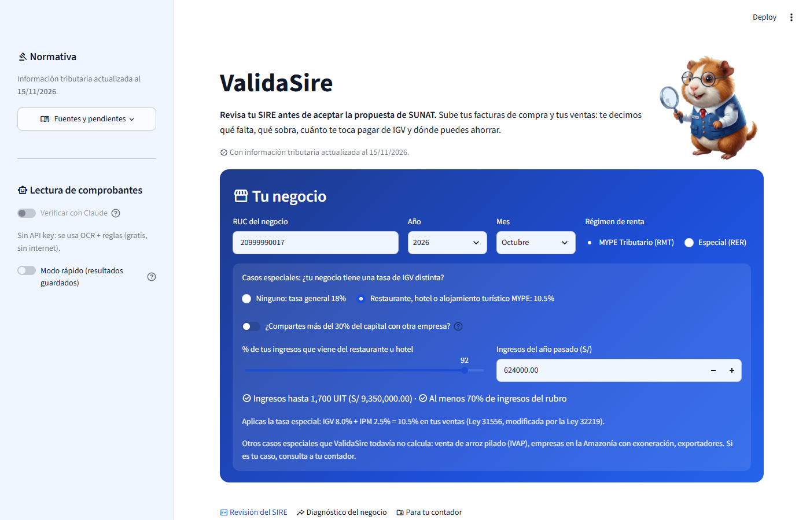
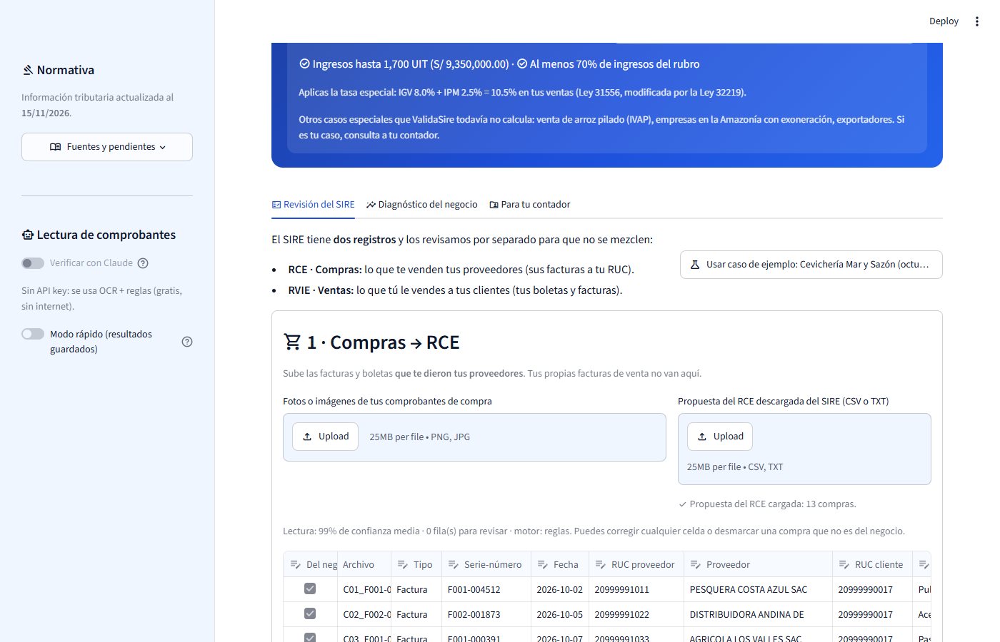
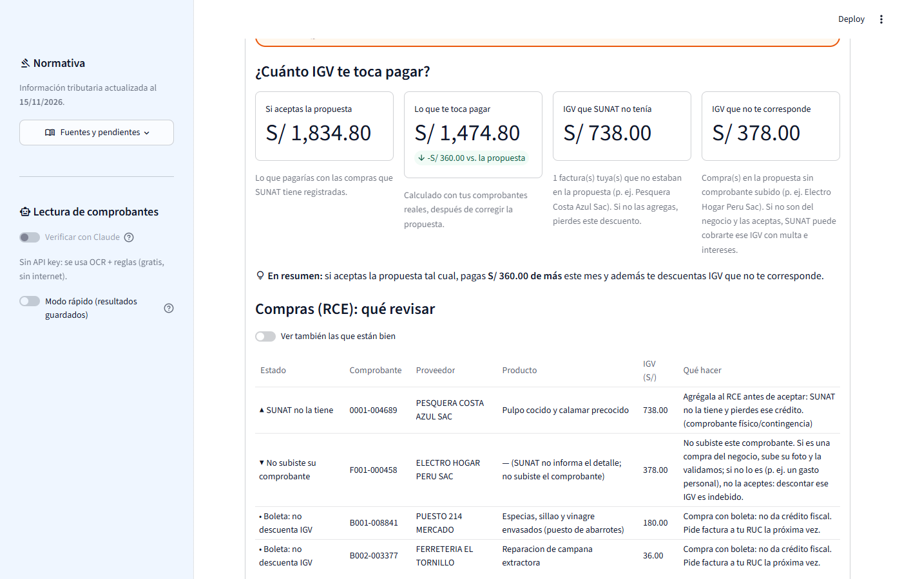
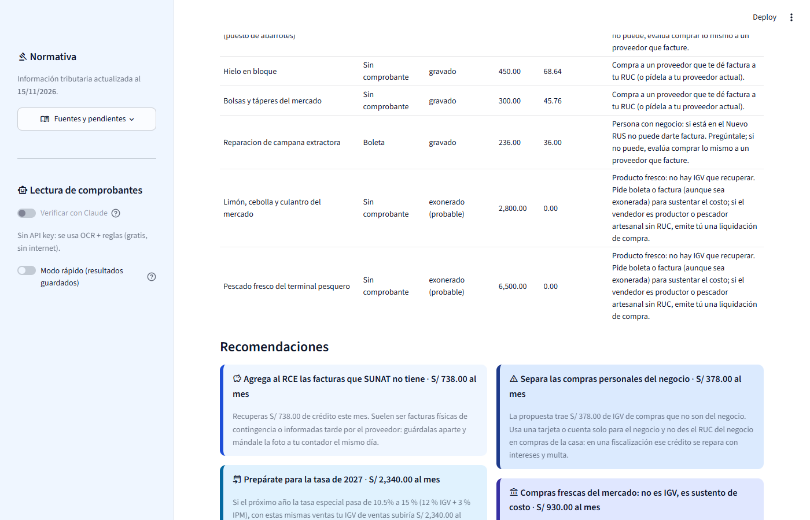
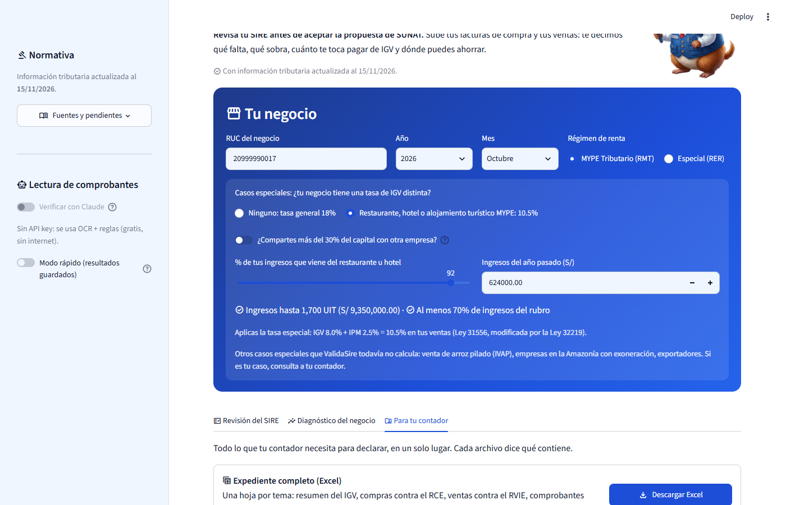
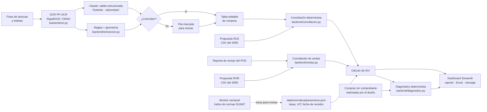

# ValidaSIRE


> **Hacemos que los dueños de restaurantes MYPE revisen su IGV del mes en 5 minutos, mediante la lectura automática de sus facturas de compra y su conciliación contra la propuesta del SIRE, con la tasa especial del rubro.**

**Demo:** https://validasire.streamlit.app (abre con el caso de ejemplo: https://validasire.streamlit.app/?demo=1) · **Video de respaldo:** _[link al video de 60-90 s]_ · **Corre en local:** ver [Cómo correrlo](#cómo-correrlo)


---

## 1. One-liner

Hacemos que los dueños de restaurantes MYPE revisen su IGV del mes en 5 minutos, mediante la lectura automática de sus facturas de compra y su conciliación contra la propuesta del SIRE, con la tasa especial del rubro.

## 2. Founder

**Britney Daily Miranda Gutiérrez** · Estudiante de Economía de 8.° ciclo en la Universidad del Pacífico (curso Data Science con Python 2026-II).

ValidaSIRE responde a las necesidades de los pequeños emprendedores con los que he estado en contacto a lo largo de mi vida. Me interesan la tesorería y la gestión financiera de empresas, y quiero que las personas con menos acceso a asesoría tengan herramientas que les sirvan en el día a día de sus negocios, sobre todo frente a la información tributaria de SUNAT, que es densa, técnica y cambia seguido. Por eso la app traduce esa información a acciones concretas: qué revisar, qué pedir al proveedor y cuánto IGV pagar.

Cómo cubro cada frente con agentes de IA:

- **Producto:** definí el problema, el usuario y el alcance (un solo flujo). Claude me ayudó a ordenar la investigación tributaria, que verifiqué contra las normas.
- **Ingeniería:** Claude Code escribió la mayor parte del código bajo mis instrucciones; yo reviso cada módulo y los tests fijan las cifras del caso.
- **Diseño:** Streamlit con componentes nativos y un tema propio; las capturas se generan con un script.
- **Ventas:** el canal son los contadores que llevan varios restaurantes. El mensaje de WhatsApp para el dueño y el reporte para el contador salen de la app.

## 3. Problema

**Quién lo sufre.** Los restaurantes MYPE de Lima (cevicherías, menús, pollerías) en el Régimen MYPE Tributario o el RER, con 3 a 15 trabajadores, que venden con boleta (POS, Yape, Plin) y compran a mayoristas y distribuidoras. Y sus contadores externos, que llevan entre 20 y 60 negocios así.

**Qué pasa.** En el SIRE, cada mes SUNAT arma una **propuesta** del Registro de Compras (RCE) y del de Ventas (RVIE) con los comprobantes electrónicos que conoce, y el contribuyente puede aceptarla, complementarla o reemplazarla. Esto es lo que dicen la prensa y los estudios:

- **El SIRE ya es masivo.** Lo usan más de 1.4 millones de contribuyentes, que han generado más de 64 millones de registros de ventas y de compras ([El Peruano, 01/07/2026](https://elperuano.pe/noticia/299237-sunat-extiende-plazo-del-sire-para-empresas-con-ingresos-superiores-a-2300-uit)).
- **La adaptación ha costado.** SUNAT tuvo que dar más plazo para subsanar sin multa las infracciones del SIRE de julio a diciembre de 2025 ([La República, 31/07/2025](https://larepublica.pe/sociedad/2025/07/31/sunat-amplia-hasta-enero-2026-el-plazo-para-corregir-errores-en-el-sire-evita-sanciones-asi-evatia-1304790)).
- **El sistema tributario de las MYPE es complejo.** Conviven cuatro regímenes (Nuevo RUS, RER, RMT y General), y ComexPerú advierte que reformarlo sin simplificar es "ampliar un sistema que ya es complejo" ([ComexPerú, Semanario 1314, 07/08/2026](https://www.comexperu.org.pe/articulo/hacia-una-reforma-tributaria-con-impacto)).
- **Cumplir es la excepción.** El 86.8 % de las MYPE opera en la informalidad y "8 de cada 10 mypes no cumplen con normas laborales ni tributarias", según ComexPerú ([Canal N](https://canaln.pe/actualidad/comexperu-informalidad-mypes-alcanza-868-2024-n485354)).
- **Los restaurantes están en la mira.** SUNAT "viene notificando esquelas de citación" a restaurantes y hoteles MYPE con vinculación económica que usaron la tasa especial, porque considera que les corresponde el 18 % ([Gestión, columna de Francisco Pantigoso, 14/09/2026](https://gestion.pe/opinion/igv-para-restaurantes-y-hoteles-bajo-lupa-noticia/)).

**Lo confirmamos en las entrevistas** (3 conversaciones en [docs/research/](docs/research/), síntesis en [sintesis.md](docs/research/sintesis.md)):

- **Dueña de cevichería (RMT):** el contador acepta la propuesta "casi siempre"; una factura grande de pescado no apareció y nunca supo por qué. Compra en el mercado con boleta o sin nada y no sabe cuánto deja de recuperar. *"Yo recibo la factura, la guardo y rezo para que salga bien."*
- **Dueño de pollería (RER):** manda fotos borrosas por WhatsApp a fin de mes, tuvo una factura con el RUC mal digitado, tiene talonarios que no sabe si sirven y compra carbón y bolsas sin comprobante. *"A veces pago por algo que no sé si me sirve."*
- **Contador con ~25 MYPE:** compara la propuesta a mano en Excel; ve faltantes por RUC errado, comprobantes de contingencia fuera de la propuesta y clientes que piden "meter" compras de la casa. *"Que lea los papeles, pero el impuesto lo calculo yo."*

**Lo más fácil es aceptarla sin revisar, y ahí aparecen dos errores opuestos que la app puede solucionar:**

| Error | Ejemplo | Costo | Qué hace ValidaSIRE |
|---|---|---|---|
| **Falta** una compra real | Una factura física de contingencia del pescado, que SUNAT no tiene | Se pierde crédito fiscal: se paga IGV de más | La lee de la foto y la marca "SUNAT no la tiene" |
| **Sobra** una compra ajena | El televisor que el dueño compró con el RUC del negocio | Crédito indebido: reparo, intereses y multa si hay fiscalización | La marca "No subiste su comprobante" para que se excluya |

Con la tasa especial de restaurantes (8 % IGV + 2,5 % IPM = 10,5 % en 2026) y compras al 18 %, **el crédito fiscal pesa casi tanto como el débito**: en nuestro caso de ejemplo, S/ 3,985 de crédito contra S/ 5,460 de débito. Un error en compras mueve mucho el IGV a pagar.

**Cuánto cuesta.** En el caso de ejemplo (ficticio pero con montos típicos), aceptar la propuesta lleva a pagar **S/ 1,834.80 en vez de S/ 1,474.80** (S/ 360 de más en un solo mes) y, además, a declarar S/ 378 de crédito indebido. Los dos errores casi se compensan, así que el total "parece razonable": solo una revisión línea por línea los encuentra. A eso se suma el riesgo de la tasa especial: con las esquelas por vinculación económica, perder el beneficio obliga a reliquidar al 18 %, y la app verifica los requisitos antes de calcular.

**Cómo lo resuelven hoy.** El dueño junta las facturas en un sobre o las manda por WhatsApp al contador. El contador descarga la propuesta en Excel y, si tiene tiempo, compara a mano; si no, acepta. Nadie revisa si cada compra es del negocio, y el dueño no sabe qué compras le sirven para descontar IGV.

## 4. Solución e insight

**Qué construimos.** Una app web donde el dueño o su contador:

0. Indica su RUC, periodo, régimen y si es un **caso especial**: restaurante, hotel o alojamiento turístico MYPE (tasa especial de la Ley 31556). La app verifica en ese momento los requisitos (ingresos hasta 1,700 UIT, 70 % del rubro y vinculación económica); si no los cumple, calcula con la tasa general.
1. **Compras → RCE.** Sube las **fotos** de las facturas y boletas que le dieron sus proveedores y la **propuesta del RCE** del SIRE. El OCR las lee (incluso una foto girada tomada con el celular) y extrae RUC, serie, fecha, producto, base, IGV y total. Claude verifica la lectura con salidas estructuradas; si las dos lecturas no coinciden, la fila queda marcada para revisar. Si sube por error una factura que emitió él mismo, la app le avisa que es una venta.
   **Devoluciones y descuentos:** una factura no se corrige; se emite una **nota de crédito** (resta) o de **débito** (suma). La app lee las notas, les pone el signo correcto aunque el archivo las traiga en positivo, las une con la factura que modifican ("IGV neto de esa compra: S/ 594") y avisa cuando SUNAT tiene una nota que el usuario no subió, cuando el usuario tiene una que SUNAT no tiene, y cuando **pagó menos que la factura sin nota de crédito** (columna "Pagado"). En ventas hace lo mismo con las notas que emite el negocio. Hay un segundo caso de ejemplo con estas situaciones.
2. **Ventas → RVIE.** Sube el reporte de ventas de su sistema de facturación o POS y la **propuesta del RVIE**. Las ventas no se suben como fotos porque ya son electrónicas.
3. Recibe **qué falta, qué sobra y qué hacer** en compras y en ventas, con el producto de cada comprobante, y el **IGV a pagar** con y sin la revisión, calculado con código determinista. La mascota, Don Cuy, le dice si puede aceptar la propuesta ("¡Cuy-dado perfecto!") o si debe revisarla primero ("¡Ojo con el SIRE!").
4. En otra pestaña recibe un **diagnóstico del negocio**: cuánto IGV podría recuperar al mes y al año, en qué compras (boletas de empresas que deberían darle factura, hielo o bolsas sin comprobante), dónde **no** hay IGV que recuperar porque el producto fresco está exonerado (pero sí costo que sustentar para Renta), cuándo aplica la **liquidación de compra**, si sus **talonarios** sirven, qué requisitos debe cumplir un comprobante para dar crédito, y recomendaciones de orden priorizadas.
5. En la pestaña **Para tu contador** descarga el expediente en **Excel** (con las fórmulas), la lista final de compras con crédito para complementar o reemplazar la propuesta, un resumen y un mensaje de WhatsApp para el dueño.
6. En la pestaña **Servicios PRO** puede pedir *Recupera tu crédito*, *Cierre anual* o *Consejería* a un contador de la red (perfiles de ejemplo en el demo), y un contador puede postular para ser aliado. En la barra lateral están los planes y la prueba gratis.

**Normativa al día.** Las tasas, la UIT y los topes viven en [data/normativa/parametros.json](data/normativa/parametros.json), con la fecha de la última revisión, que la app muestra ("Con información tributaria actualizada al 15/11/2026"). Cada lunes, un monitor ([scripts/monitor_normativa.py](scripts/monitor_normativa.py), en GitHub Actions) lee el índice oficial de Resoluciones de Superintendencia de SUNAT, filtra las normas nuevas sobre IGV, SIRE, comprobantes, liquidación de compra, etc., y abre un issue para revisarlas. **Ningún cambio de tasa se aplica solo:** una persona lee la norma, actualiza el JSON y los tests deben pasar. Si pasan más de 45 días sin revisión, la app lo advierte.

**Insight.**

- El SIRE cambió quién arma el registro: antes lo armaba el contador con los comprobantes en la mano; ahora SUNAT propone y el camino fácil es "Aceptar". **El error pasó de ser de digitación a ser de omisión y de aceptación**, y eso solo se detecta comparando contra los documentos físicos del negocio.
- La revisión no necesita "inteligencia" para los números: necesita **leer bien** (OCR + LLM) y **calcular con reglas** (código). El LLM nunca calcula impuestos; las tasas están en un solo archivo, porque cambian por ley (en 2027 la tasa especial sube a 12 % + 3 % IPM, y hay una reforma en discusión).
- **El dueño no necesita saber de impuestos, necesita saber qué pedir.** Pedir factura por el limón no recupera nada (está exonerado), pero pedirla por el hielo, las bolsas o a la distribuidora que hoy da boleta sí. Traducimos la ley a una lista de proveedores y montos.
- El ahorro por restaurante es pequeño en soles (el Consejo Fiscal estima que una empresa RMT promedio paga unos S/ 7,000 de IGV al año), así que **el cliente que paga es el contador**: un mismo contador revisa 30 restaurantes en una mañana.

## 5. Why now

- **El SIRE ya es obligatorio para las MYPE del RER y del RMT** y lo usan más de 1.4 millones de contribuyentes ([El Peruano, 2026](https://elperuano.pe/noticia/299237-sunat-extiende-plazo-del-sire-para-empresas-con-ingresos-superiores-a-2300-uit)). Hace pocos años no existía una "propuesta" contra la cual conciliar.
- **El OCR ya corre gratis en CPU.** Los modelos PP-OCR (PaddleOCR) exportados a ONNX pesan ~32 MB y leen un comprobante en ~1,5 s en un servidor gratuito, sin GPU.
- **Los LLM con salidas estructuradas** devuelven un JSON validado contra un esquema (Pydantic) por menos de un centavo de dólar por comprobante.
- **La tasa especial cambia en 2027** (de 10,5 % a 15 %) y el IPM sube cada año hasta 2029: los restaurantes necesitan recalcular con parámetros, no con la plantilla de Excel del año pasado.

## 6. Demo

**URL:** https://validasire.streamlit.app · **Caso de ejemplo directo:** `/?demo=1` · **Video:** _[link]_

| 1. Tu negocio y casos especiales | 2. Compras leídas por el OCR | 3. Resultado |
|---|---|---|
|  |  |  |
| **4. Qué revisar, con el producto** | **5. Diagnóstico del negocio** | **6. Para tu contador** |
|  |  |  |

**Caso de ejemplo:** Cevichería Mar y Sazón E.I.R.L., octubre de 2026. 15 comprobantes de compra (13 facturas y 2 boletas), una propuesta del RCE con dos errores plantados, y ventas por S/ 52,000 (31 resúmenes diarios de boletas y 6 facturas) que coinciden con la propuesta del RVIE. **Todo es ficticio** (RUC, razones sociales, montos). Detalle en [data/caso_sintetico/](data/caso_sintetico/).

### Arquitectura



### Modelos y APIs, y por qué

| Pieza | Qué usamos | Por qué |
|---|---|---|
| OCR | Modelos **PP-OCRv6** de PaddleOCR vía **RapidOCR + ONNX Runtime**, en el servidor | Los mismos modelos de la sesión 10, sin PyTorch ni GPU: entran en el plan gratuito de Streamlit Cloud. La imagen del comprobante no sale del servidor. |
| Verificación de la lectura | **Claude** (`claude-opus-5-5` por defecto, configurable con `CLAUDE_MODEL`) con `messages.parse` y un esquema Pydantic | Devuelve un `Comprobante` validado; solo recibe el texto del OCR, no la imagen. Si no hay API key, la app funciona igual con reglas. |
| Cálculo y diagnóstico | Python puro (pandas) | Los impuestos no se le piden a un LLM: código determinista, con tests, y fórmulas visibles en el Excel (lo pidió el contador entrevistado). |
| Interfaz | Streamlit + Altair | Un solo archivo, despliegue gratis. |

### Cómo correrlo

```bash
git clone https://github.com/BritneyMiranda/validasire.git
cd validasire
python -m venv .venv && source .venv/bin/activate   # en Windows: .venv\Scripts\activate
pip install -r requirements.txt
cp .env.example .env            # opcional: pon tu ANTHROPIC_API_KEY para la verificación con Claude
streamlit run app/streamlit_app.py
```

Abre http://localhost:8501 y pulsa **"Usar caso de ejemplo"**. Pruebas: `pytest`. Evaluación de la extracción: `python scripts/evaluar_extraccion.py`.

**Despliegue (Streamlit Community Cloud):** New app → repo validasire, rama `main`, archivo `app/streamlit_app.py`, Python 3.12. La API key va en *Settings → Secrets* como `ANTHROPIC_API_KEY = "..."`, nunca en el repo.

### Evaluación

Sobre los 15 comprobantes del caso, OCR + reglas extrae **100 % de los campos** (tipo, serie, fecha, RUC del proveedor y del cliente, base, IGV y total), incluida la foto girada, y las cifras finales coinciden con `resultado_esperado.json`. Detalle: [docs/evaluacion_extraccion.md](docs/evaluacion_extraccion.md). Es un caso sintético con imágenes limpias: con fotos reales la exactitud será menor, y por eso existe la doble lectura y la tabla editable.

## 7. Modelo de negocio

**Tres públicos:** el dueño MYPE (con o sin contador), el contador independiente y el estudio contable. Dos fuentes de ingreso: **suscripciones** (la base recurrente) y **servicios de la red de contadores aliados** (comisión).

> Es el modelo **propuesto**: en el demo no hay registro, cuentas ni pagos. Los precios son referenciales y salen de las referencias de mercado de la tabla siguiente.

**Precios de referencia del mercado** (consultados en noviembre de 2026; son sitios comerciales y precios orientativos, por confirmar con contadores):

| Qué | Precio | Fuente |
|---|---|---|
| Contabilidad mensual de una MYPE en Lima | S/ 400 a S/ 900 al mes (promedio ~S/ 500) | [Cuánto Me Cuesta: contador en Perú](https://cuantomecuesta.com/pe/contador-contabilidad/) (precios de abril de 2026) |
| Contabilidad mensual por régimen, en Lima | RMT: S/ 300 a S/ 600 · RER: S/ 150 a S/ 300 al mes | [KOM: contadores en Perú](https://kom.pe/landing-page-contadores-peru/) (actualizado el 25/10/2026) |
| Consultoría contable o tributaria | S/ 80 a S/ 200 por hora | [Cuánto Me Cuesta](https://cuantomecuesta.com/pe/contador-contabilidad/) |
| Asesoría tributaria por videollamada | S/ 60 (15 min), S/ 110 (30 min), S/ 200 (60 min) | [B&B Abogados y Contadores](https://bybconsultores.pe/asesoria-tributaria-zoom/) |
| Declaración anual de renta (persona natural) | S/ 80 a S/ 400 | [Cuánto Me Cuesta](https://cuantomecuesta.com/pe/contador-contabilidad/) |

Cómo se fijaron nuestros precios: el plan **Dueño** (S/ 19) es menos del 5 % de lo que una MYPE paga al mes por su contabilidad; la **Consejería** de 30 min (S/ 49) cuesta menos de la mitad que la asesoría de 30 min publicada (S/ 110); y el **Cierre anual** (S/ 290) es una estimación propia, porque no encontramos un precio público de la declaración anual de una MYPE (la de persona natural cuesta hasta S/ 400 y una MYPE es más compleja).

### Suscripciones

| Plan | Para quién | Precio | Cómo se verifica |
|---|---|---|---|
| **Prueba gratis** | Todos | Un mes completo revisado | Solo vale si los comprobantes subidos están a nombre del RUC ingresado (la app ya lee el RUC del cliente en cada factura). Una vez por RUC y por correo o celular. |
| **Dueño** | 1 negocio | **S/ 19 al mes** o S/ 190 al año | RUC activo en el padrón de SUNAT |
| **Contador** | Contador independiente | **S/ 49 al mes** con 3 RUC + **S/ 8 por RUC adicional** (máximo S/ 249) | Colegiatura y DNI contra el padrón del Colegio de Contadores de su región (si no hay consulta en línea, validación manual al inicio) |
| **Estudio** | Estudio contable | **Desde S/ 299 al mes**: varios usuarios, reportes por cliente, la app con su propia marca | RUC del estudio con actividad de contabilidad (CIIU 6920) |

El dueño la usa una vez al mes y paga poco; el contador paga por lo que usa ("pagas por cada empresa que revisas") y le cobra a cada cliente mucho más de S/ 8. Los datos de registro (DNI, colegiatura, RUC) requieren consentimiento y política de privacidad (Ley 29733).

### Red de contadores aliados

ValidaSIRE conecta; **la asesoría la da un contador colegiado**. El cliente paga el servicio por la app y el contador recibe el **80 %** (ValidaSIRE, **20 %** de comisión). Los contadores postulan desde la app ("¿Eres contador? Únete a nuestros aliados"), sin pago mensual por aparecer.

| Servicio | Qué incluye | Precio referencial | Para ValidaSIRE |
|---|---|---|---|
| **Recupera tu crédito** | Revisión de los últimos 12 meses: facturas y notas de crédito que no se anotaron | **15 % de lo recuperado**; si no se recupera nada, no se paga | 20 % de ese 15 % |
| **Cierre anual** | 12 meses ya revisados, renta anual estimada, pagos a cuenta, saldo a favor y declaración anual | **S/ 290 por año** | S/ 58 |
| **Consejería** (incluye esquelas de SUNAT) | Videollamada de 30 min; si llega una esquela, la app la explica en simple antes | **S/ 49 por consulta** o **S/ 79 al mes** (2 consultas + esquelas) | S/ 9.80 / S/ 15.80 al mes |

**Siguiente paso, no oferta actual:** que el contador aliado emita cada mes las liquidaciones de compra a pescadores y productores sin RUC (requiere su acceso al SOL del cliente; ValidaSIRE nunca pide la Clave SOL).

### Costos y margen

**Costo por RUC al mes** (supuesto: 80 comprobantes al mes; tipo de cambio S/ 3.75 por US$):

| Concepto | Con Claude Opus 5.5 | Con Claude Haiku 5.5 |
|---|---|---|
| LLM (verificación de la lectura) | ≈ S/ 3.50 | ≈ S/ 0.10 |
| Servidor (OCR en CPU, VM de ~US$ 24 al mes entre ~300 RUC) | ≈ S/ 0.30 | ≈ S/ 0.30 |
| Pasarela de pago (~4 %) | S/ 0.76 (plan Dueño) | S/ 0.76 |
| **Margen plan Dueño (S/ 19)** | **S/ 14.44 (76 %)** | **S/ 17.84 (94 %)** |
| **Margen por RUC adicional del contador (S/ 8)** | S/ 3.88 (49 %) | S/ 7.28 (91 %) |

- **Con estos precios, Haiku 5.5 debe ser el modelo de producción**, en cuanto la evaluación muestre que mantiene la exactitud (la app ya registra los tokens por comprobante para medirlo). Opus queda para los casos marcados "revisar".
- **Sin API key**, el producto funciona con OCR + reglas a costo casi cero: es el plan de respaldo si sube el precio del LLM.
- **Por validar con el contador entrevistado:** si aceptaría clientes referidos, si el 20 % le parece justo y cuánto cobra hoy por un cierre anual.

**Qué sigue:** probar con el contador entrevistado con su propia propuesta del SIRE (anonimizada), leer el layout oficial de exportación del SIRE y del RVIE (hoy las boletas se agrupan por resumen diario), recibir las fotos directamente por WhatsApp (el canal que ya usan los dueños) y sumar otros casos especiales (IVAP del arroz pilado, Amazonía, exportadores).

## 8. Herramientas del curso

| Herramienta (sesión) | Dónde está | Por qué esta |
|---|---|---|
| **Document AI con PaddleOCR** (sesión 10) | [backend/ocr.py](backend/ocr.py) | El dato de entrada es una foto de un papel. Usamos los modelos PP-OCR de la clase, exportados a ONNX para que corran en un servidor gratuito. |
| **LLMs con salidas estructuradas** (sesión 08) | [backend/extraccion.py](backend/extraccion.py), [backend/modelos.py](backend/modelos.py), [ai/prompts/](ai/prompts/extraccion_comprobante.md) | En clase vimos el modo JSON; aquí el esquema Pydantic garantiza el formato y lo comparamos con un extractor de reglas para detectar errores. |
| **Dashboards** (sesión 05) | [app/streamlit_app.py](app/streamlit_app.py) | El dueño necesita ver tres números y una lista de acciones, no un Excel. |
| **Scraping** (sesión 03) | [scripts/monitor_normativa.py](scripts/monitor_normativa.py), [.github/workflows/](.github/workflows/monitor_normativa.yml) | La ley cambia (tasa 2027, IPM, liquidación de compra en 2026): el monitor lee el índice oficial de SUNAT cada semana y avisa qué revisar. |
| **Despliegue y evaluación** (sesión 12) | [scripts/evaluar_extraccion.py](scripts/evaluar_extraccion.py), [tests/](tests/), [docs/evaluacion_extraccion.md](docs/evaluacion_extraccion.md) | Exactitud por campo contra la verdad terreno y tests que fijan las cifras del caso; despliegue en Streamlit Community Cloud. |

## 9. Qué hizo el agente

Usé **Claude Code** como co-founder técnico. Lo que hizo:

- **Generó la mayor parte del código:** `backend/` (OCR, extracción por reglas y con Claude, conciliación y cálculo de IGV), `app/streamlit_app.py`, los tests y los scripts de evaluación, capturas y generación de comprobantes.
- **Mejoró el caso sintético:** detectó que, en la primera versión, la factura faltante tenía el RUC del cliente mal digitado, lo que en la práctica **no** da crédito en el mes (hay que anularla y reemitirla). La cambió por una factura física de contingencia y movió el caso del RUC errado a una alerta propia. También regeneró las imágenes porque las razones sociales largas se montaban sobre el recuadro de la serie.
- **Investigó y verificó parámetros:** tasas 2026-2027 (Leyes 31556, 32219 y 32387), Apéndice I prorrogado a 2028 (Ley 32542) y cambios de 2026 en la liquidación de compra (RS 000047-2026/SUNAT). Quedaron en `data/normativa/parametros.json` con su fuente. Al verificar el Apéndice I detectó que el caso cobraba IGV por limón y verduras (exonerados) y cambió esas descripciones por productos gravados.
- **Construyó el diagnóstico y el monitor de normativa** a partir de mis notas de entrevistas: requisitos del crédito fiscal, talonarios, liquidación de compra, exportación a Excel y el scraping del índice de SUNAT.
- **Rediseñó la app con mis comentarios de prueba:** nombre ValidaSIRE, mi mascota en los mensajes de resultado, casos especiales antes de subir archivos, compras y ventas separadas (RCE y RVIE), producto en cada hallazgo, cifras explicadas en lenguaje simple, diagnóstico y descargas en pestañas propias. Al preparar las imágenes de la mascota quitó el fondo y **borró el logo de SUNAT del chaleco**, para que la app no parezca un producto oficial.
- **Redactó** este README y la guía de entrevistas.

Lo que hice yo: elegir el problema y el usuario, acotar el alcance a un solo flujo, decidir que el LLM no calcula impuestos, realizar las entrevistas, revisar el código y las cifras, y desplegar.

---

### Estructura

```
app/            Streamlit (la interfaz)
backend/        OCR, extracción, conciliación, cálculo y reportes
ai/prompts/     prompt de extracción
data/           caso sintético (ficticio): comprobantes, propuesta, ventas, resultados esperados
docs/           capturas, arquitectura, evaluación y research/ (3 conversaciones)
data/normativa/ tasas y parámetros tributarios con fecha de revisión
scripts/        generación de comprobantes, evaluación y capturas
tests/          pytest
```

**Aviso:** ValidaSIRE es un proyecto independiente, no es un producto de SUNAT ni está afiliado a ella. Es una herramienta de revisión y no reemplaza la asesoría de un contador. Información tributaria actualizada al 15/11/2026; verifícala antes de declarar.

**Licencia:** el código está bajo licencia MIT. **La mascota Don Cuy (imágenes en `assets/mascota/`) es © Britney Daily Miranda Gutiérrez, todos los derechos reservados**, y no está incluida en la licencia MIT.
