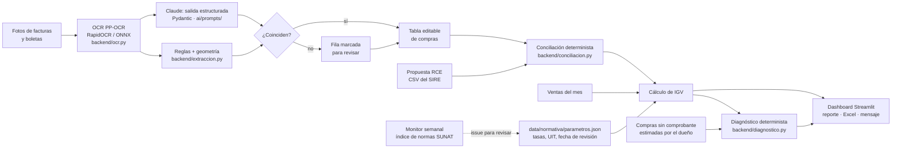

# Arquitectura de Cuadra

| Capa | Archivo | Qué hace |
|---|---|---|
| Interfaz | `app/streamlit_app.py` | Subida de comprobantes, tabla editable, resultado, diagnóstico y descargas. |
| OCR (Document AI) | `backend/ocr.py` | Modelos PP-OCRv6 de PaddleOCR en ONNX (RapidOCR), en CPU. Devuelve texto con posición. |
| Extracción | `backend/extraccion.py`, `backend/modelos.py`, `ai/prompts/` | Reglas por geometría + Claude con salida estructurada (Pydantic). Si difieren, se marca para revisar. |
| Conciliación y cálculo | `backend/conciliacion.py` | Compara contra la propuesta del RCE y calcula el IGV con tasas parametrizadas. |
| Diagnóstico | `backend/diagnostico.py` | IGV recuperable, exonerados, renta por costos sin sustento, recomendaciones y Excel. |
| Normativa | `data/normativa/parametros.json`, `scripts/monitor_normativa.py` | Tasas con fecha de revisión; monitor semanal del índice de SUNAT (GitHub Actions). |
| Calidad | `tests/`, `scripts/evaluar_extraccion.py` | 18 tests y evaluación por campo contra la verdad terreno. |

El LLM solo lee los comprobantes: ningún impuesto se calcula con IA.
